# Research Note: Short-Horizon BTC Direction vs Polymarket 5m Markets

**Author:** ron1n97  
**Status:** portfolio research write-up  
**Stack:** Python, LightGBM, Transformer, Binance OHLCV, Polymarket CLOB  
**Code:** this repository

---

## Abstract

I built short-horizon BTC direction models and tried to trade them on Polymarket Up/Down markets. On candle / futures-style evaluation the models looked usable. On Polymarket, after **executable ask prices**, the same signal was typically **negative EV**. Early live PnL (~$200) is treated as noise, not proof of alpha.

---

## 1. Problem

Polymarket runs recurring BTC Up/Down binaries. A share bought at ask \(a\) pays 1 if you are right and 0 if wrong, so roughly:

\[
\mathrm{EV} \approx WR - a
\]

Directional accuracy alone is not enough. You need win rate above the ask you actually pay.

**Question:** can a Binance-based 5-minute direction model clear that bar on Polymarket?

### Why BTC (honest), and what about the horizon

Before locking the mainline I scanned **other crypto Up/Down underlyings** on the same market family (ETH, SOL, BNB, DOGE, XRP, HYPE) and also compared **BTC 5m vs 15m** walk-forwards.

**Coin choice — can be stated cleanly.**  
5m returns are tightly tied to BTC (ETH≈0.81, SOL≈0.75, …); direction agreement with BTC is high (~0.69–0.80). A multi-coin book is mostly **correlated BTC risk**, not diversification — weak reason to merge alts into one “united” strategy. On a common LightGBM walk-forward scan, gated **BTC** was among the strongest coins on selective accuracy, and BTC had the cleanest YES/NO pair availability in a microstructure check of recent crypto 5m markets. So concentrating on **BTC** is justified by the data.

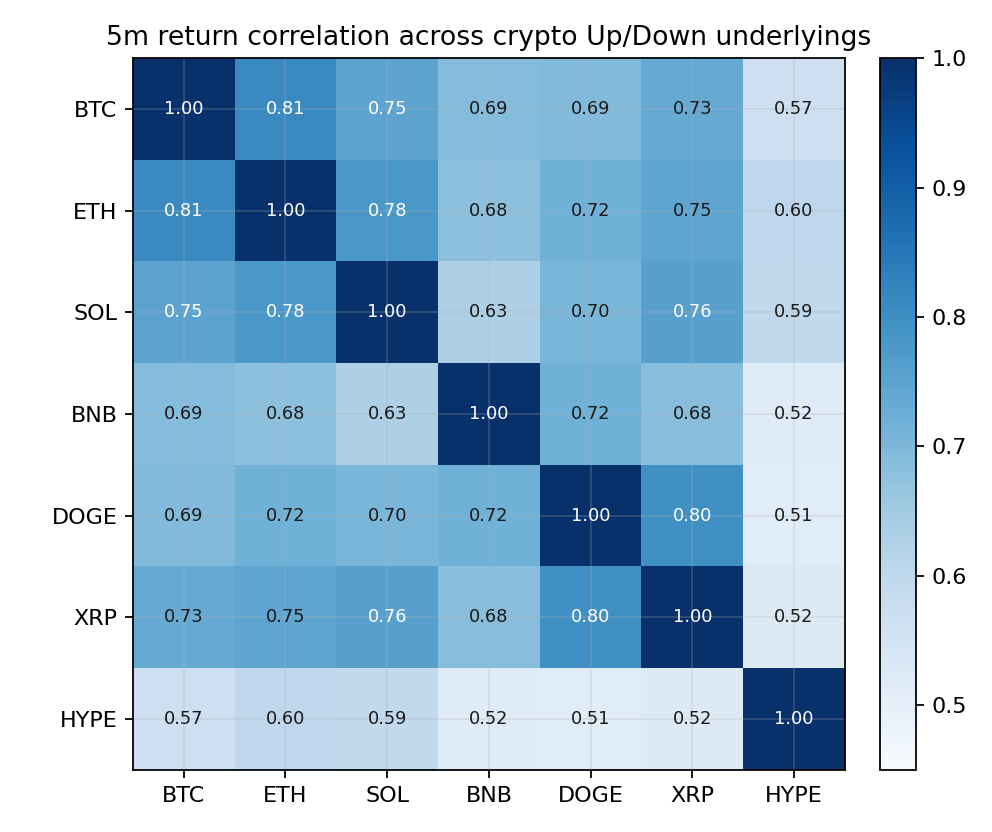

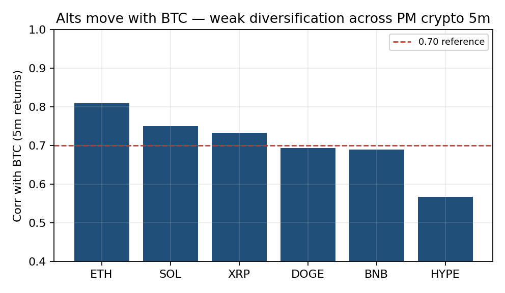

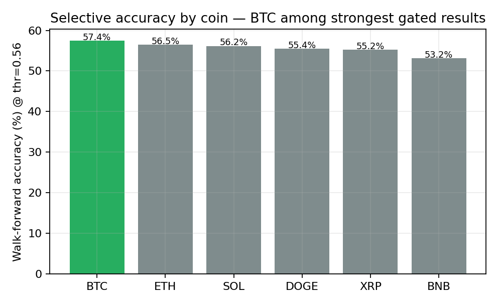

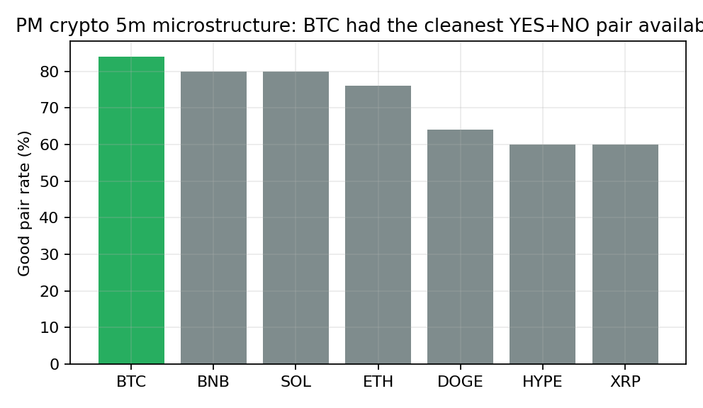

**Horizon — do not overclaim.**  
The same lab scan does **not** show that 5m dominated 15m. In the monthly walk-forward file at thr=0.55, **15m looked at least as strong** (higher mean WR / AUC / coverage in that aggregate). This note still centers on **BTC 5m** because that is the system that was built out and live-tested most heavily — not because a horizon bake-off crowned 5m the winner.

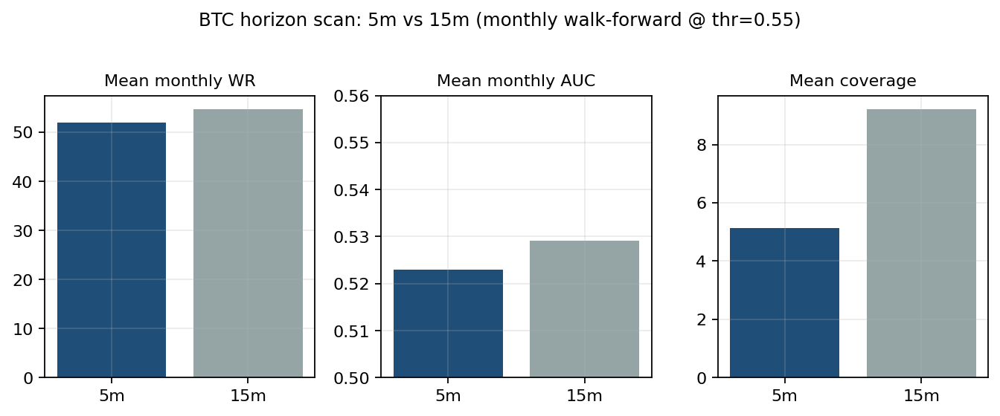

---

## 2. Two evaluations

I kept two scoreboards separate:

1. **Candle evaluation** — predict the next BTC 5m candle; optional futures-style simulator with fees / leverage.  
2. **Polymarket evaluation** — same idea mapped onto contract prices, EV at ask, shadow / live fills.

A good candle score does not imply a good Polymarket strategy.

---

## 3. Candle-side work

Details: [`model_card.md`](model_card.md).

I trained LightGBM and a small candle Transformer on Binance BTC 5m features (ETH used as context), then combined them as a weighted ensemble for experiments. On the held-out candle slice the Transformer dominated discrimination; LightGBM was weak alone; the blend was close to the Transformer.

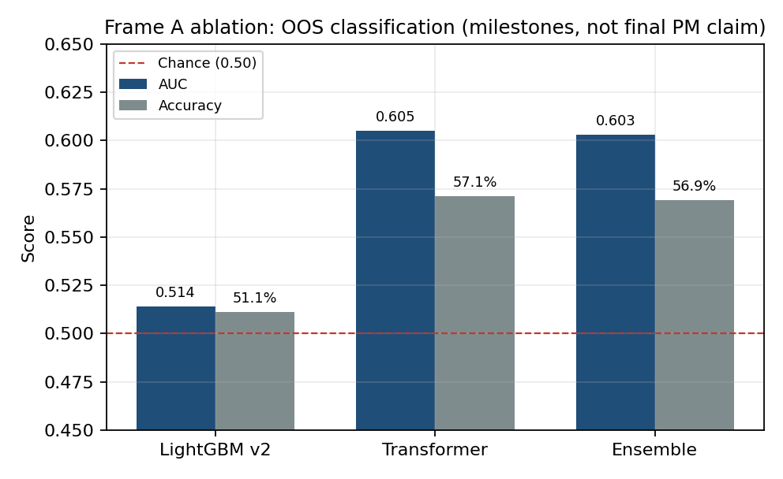

Confidence gating helped: trading only high-confidence bars raised accuracy while cutting coverage.

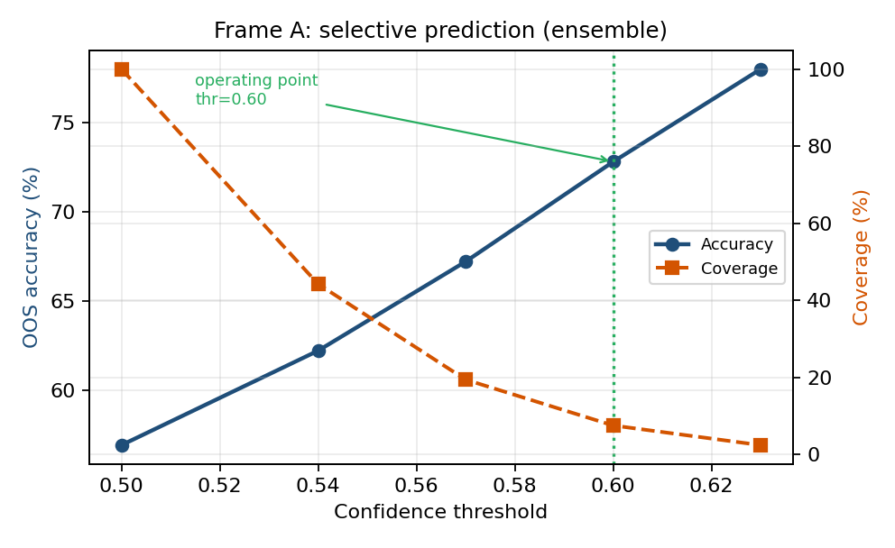

A futures-style simulator on those gated signals produced strong headline OOS returns (reported +322%, max DD −17.4%, six positive months). That simulator is **not** Polymarket.

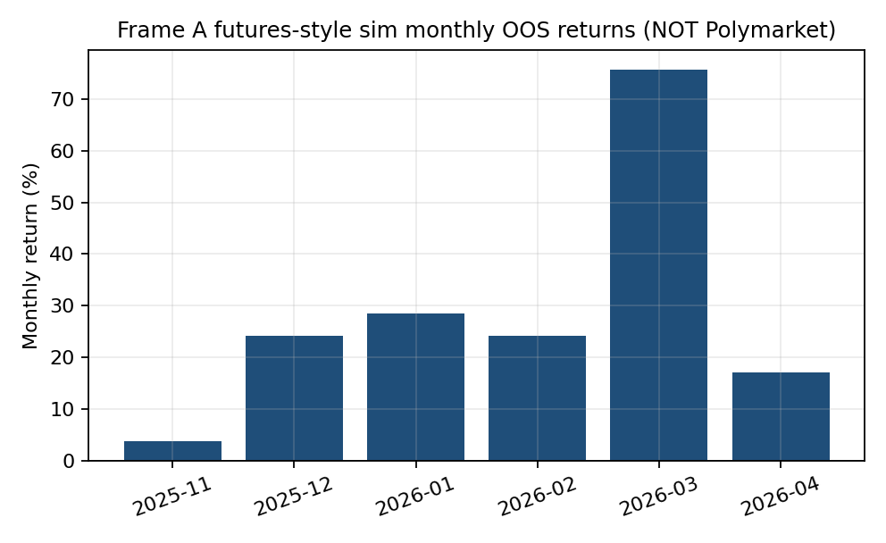

I also calibrated multi-horizon probability heads for Polymarket-oriented features; isotonic calibration straightened reliability curves, but calibration without edge still loses money at a bad ask.

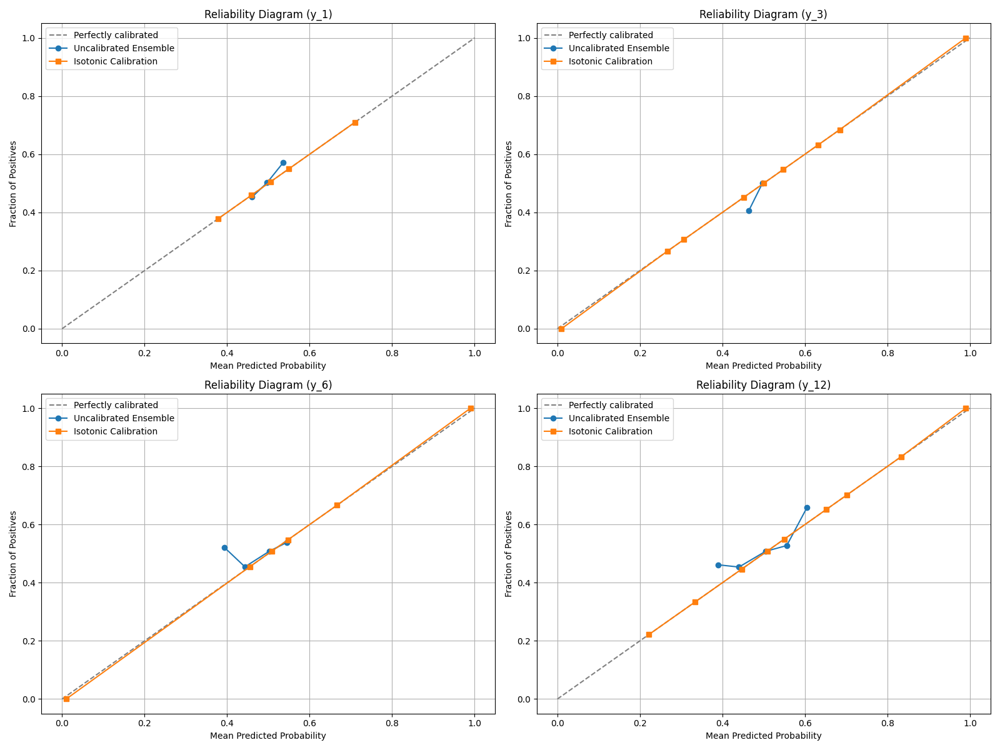

---

## 4. Why Polymarket failed the transfer

### 4.1 Economics

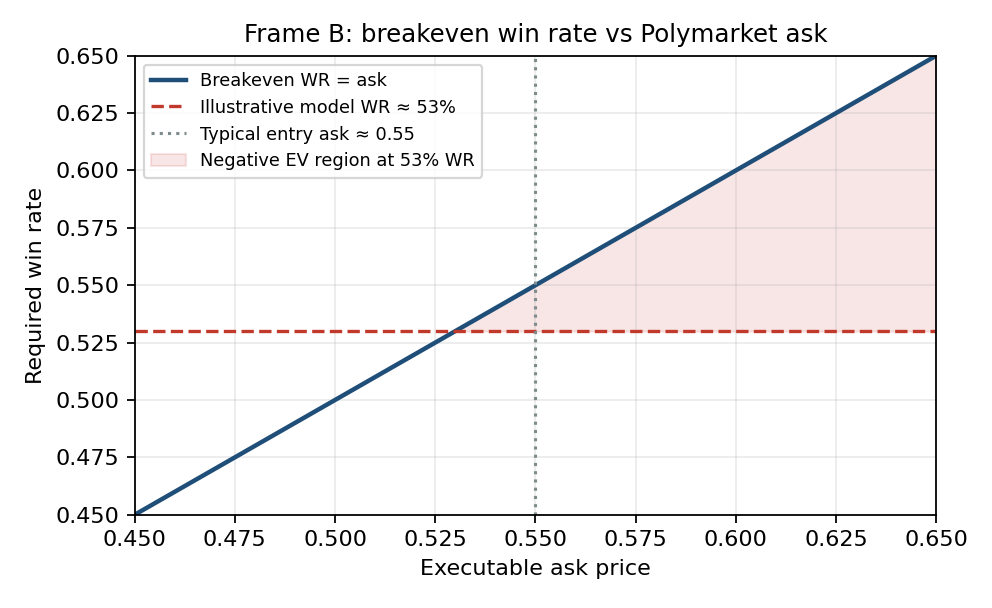

In live diagnosis the useful operating region looked like ~**53%** hit-rate against asks around **0.54–0.56**. At ask 0.55 that is about **−2% EV per trade**. Breakeven is 55%; a workable edge needs roughly 57–58%+ after selection, or systematically cheaper entries.

### 4.2 What broke in practice

See [`failure_modes.md`](failure_modes.md).

- Backtests that assumed mid / even odds overstated edge versus real asks.  
- One holdout understated regime variance; walk-forward was stricter.  
- Trading every bar diluted rare high-confidence regimes.  
- Production plumbing (bot, dry-run/live, redeemer) worked; the **signal** did not clear venue costs.  
- Early live ~$200 on a small bankroll is an anecdote.

### 4.3 What the “explosive bankroll” charts are (and are not)

The figure below is **not** the proof that “Up-only / Down-only with bankroll ramping beats the model.”  
It is a cautionary plot from the lab: **proxy / even-odds bankroll paths** can explode and then vanish, while short **real** windows look unstable. That is a reason to distrust fantasy bankroll curves — not a claim that directional one-sided ramping is the alpha.

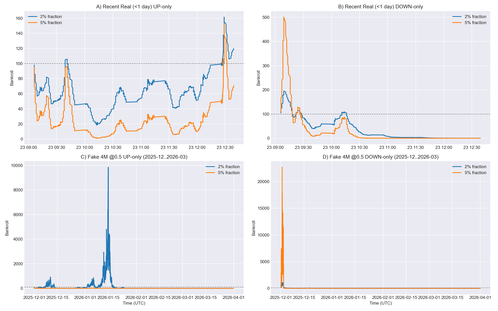

**Actual rejection rule used here:** EV at executable ask, plus live/shadow reconciliation — not “compare to Up-only Kelly rocket.”

---

## 5. Pipeline

```
Binance OHLCV → features → direction models
        ↓
walk-forward + confidence / regime gates
        ↓
map to Polymarket (side, size, EV vs ask)
        ↓
shadow / dry-run → tiny live
        ↓
truth recompute → keep, gate, or kill
```

Code: `research/features/`, `research/eval/`. Production shape: [`production_appendix.md`](production_appendix.md). Process notes: [`decision_log.md`](decision_log.md).

---

## 6. Conclusion

**Candle models:** some short-horizon structure; gating helps; futures-style sim looked strong.  
**Polymarket:** under real asks, the shipped systems did not show a validated edge.

The valuable outcome is the loop that can **kill** a strategy for the right reason.

---

## 7. If continued

1. Walk-forward without tuning gates on the same OOS slice.  
2. Reconstruct historical asks for every candidate entry.  
3. Optimize calibration / Brier, not accuracy theater.  
4. Put microstructure (spread, imbalance, time-in-window) first.

---

## 8. Limits

Curated public extract. Figures mix reported lab tables with process plots. No wallet keys or redeemer secrets.
